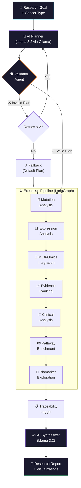
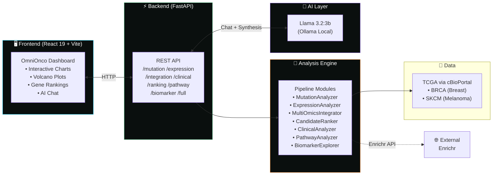

<p align="center">
  
  
  
  
  
</p>

<h1 align="center">
  🧬 OmniOnco AI
</h1>

<p align="center">
  <strong>AI-Powered Multi-Omics Cancer Research Agent</strong><br/>
  <em>Goal-driven pipeline that autonomously plans, executes, and synthesizes integrated cancer genomics analysis</em>
</p>

<p align="center">
  <a href="#-architecture">Architecture</a> •
  <a href="#-features">Features</a> •
  <a href="#-quick-start">Quick Start</a> •
  <a href="#-api-reference">API</a> •
  <a href="#-project-structure">Structure</a> •
  <a href="#-how-it-works">How It Works</a>
</p>

---

## 🎯 What is OmniOnco AI?

OmniOnco AI is a **full-stack, goal-driven AI agent** that performs end-to-end multi-omics cancer data analysis. Give it a research question and a cancer type — it autonomously **plans** the analysis workflow, **executes** each bioinformatics step, **integrates** results across data modalities, and **synthesizes** a structured research report using an LLM.

> **Example:** *"Identify convergent driver genes in breast cancer and investigate associated pathways"*
>
> The agent plans → mutation analysis → differential expression → multi-omics integration → pathway enrichment → AI-synthesized report — all automatically.

---

## 🏗 Architecture



### System Overview



---

## ✨ Features

| Module | What It Does | Method |
|--------|-------------|--------|
| **🔬 Mutation Analysis** | Somatic mutation frequency, variant classification, TMB | Patient-level gene counting on MAF data |
| **📊 Differential Expression** | Identifies up/downregulated genes | Welch's t-test, log2FC, Benjamini-Hochberg correction |
| **🔗 Multi-Omics Integration** | Finds convergent driver genes | Set intersection: Mutated ∩ (Upregulated ∪ Downregulated) |
| **📈 Evidence Ranking** | Composite scoring of candidate genes | Min-max normalized (mutation + expression + pathway) scores |
| **🏥 Clinical Analysis** | TMB, MSI, aneuploidy, grade distributions | Descriptive statistics on clinical covariates |
| **🛤️ Pathway Enrichment** | Maps genes to biological pathways | Enrichr API → KEGG 2021 + GO Biological Process |
| **🎯 Biomarker Exploration** | Primary vs. Metastasis classification | Logistic Regression + Random Forest (5-fold stratified CV) |
| **🧠 AI Planner** | Autonomously selects which analyses to run | LLM-based intent parsing with validation loop |
| **✍️ AI Synthesizer** | Generates structured research reports | LLM with computed results as grounded context |
| **💬 AI Chat** | Interactive Q&A about results | Context-aware conversational agent |

### 🛡️ Responsible AI Design

- LLM is used **only** for planning and report writing — all science is deterministic
- Every computed result is labeled `COMPUTED RESULT` vs `AI INTERPRETATION`
- Biomarker module includes a clinical disclaimer
- Traceability logs capture goals, plans, thresholds, and sample counts

---

## 🚀 Quick Start

### Prerequisites

| Tool | Purpose |
|------|---------|
| **Python 3.10+** | Backend & pipeline |
| **Node.js 18+** | Frontend build |
| **[Ollama](https://ollama.com)** | Local LLM inference |

### 1. Clone & Setup

```bash
git clone https://github.com/Archanagowda05/cancer_research.git
cd cancer_research
```

### 2. Install Ollama + Model

```bash
# Install Ollama from https://ollama.com, then:
ollama pull llama3.2:3b
```

### 3. Download TCGA Data

Download from [cBioPortal](https://www.cbioportal.org/) and place in:
```
data/raw/
├── BRCA/
│   ├── data_mutations.txt
│   ├── data_mrna_seq_v2_rsem.txt
│   └── data_clinical_sample.txt
└── SKCM/
    ├── data_mutations.txt
    ├── data_mrna_seq_v2_rsem.txt
    └── data_clinical_sample.txt
```

### 4. Backend Setup

```bash
python -m venv venv
venv\Scripts\activate          # Windows
# source venv/bin/activate     # Linux/macOS

pip install -r requirements.txt
```

### 5. Start the API Server

```bash
python api_server.py
# → OmniOnco AI API  →  http://localhost:8001
# → Swagger Docs     →  http://localhost:8001/docs
```

### 6. Start the Frontend

```bash
cd frontend
npm install
npm run dev
# → http://localhost:5173
```

---

## 🔌 API Reference

| Endpoint | Method | Description |
|----------|--------|-------------|
| `/health` | GET | Health check |
| `/mutation/{cancer_type}` | GET | Mutation frequency, variant types, TMB |
| `/expression/{cancer_type}` | GET | Differential expression + volcano data |
| `/integration/{cancer_type}` | GET | Convergent driver genes |
| `/clinical/{cancer_type}` | GET | Clinical variable summaries |
| `/ranking/{cancer_type}` | GET | Evidence-based gene ranking |
| `/pathway/{cancer_type}` | GET | KEGG + GO enrichment results |
| `/biomarker/{cancer_type}` | GET | ML classification metrics |
| `/full/{cancer_type}?goal=...` | GET | Full pipeline with optional custom hypothesis |
| `/plan` | POST | AI-powered workflow planning |
| `/chat` | POST | Conversational AI assistant |

> `cancer_type` = `BRCA` or `SKCM`

---

## 📂 Project Structure

```
cancer_research/
├── 🤖 agent/
│   └── orchestrator.py          # LangGraph state machine (12 nodes)
│
├── 🔬 pipeline/
│   ├── mutation.py              # MutationAnalyzer — MAF parsing, TMB
│   ├── expression.py            # ExpressionAnalyzer — DE, volcano plots
│   ├── integrator.py            # MultiOmicsIntegrator — convergence logic
│   ├── ranker.py                # CandidateRanker — composite scoring
│   ├── clinical.py              # ClinicalAnalyzer — clinical covariates
│   ├── pathway.py               # PathwayAnalyzer — Enrichr API
│   └── biomarker.py             # BiomarkerExplorer — ML classification
│
├── 🖥️ frontend/
│   └── src/
│       ├── App.jsx              # Main dashboard (charts, panels, chat)
│       ├── LoadingAnimation.jsx # Animated splash screen
│       └── WelcomeIntro.jsx     # Welcome overlay
│
├── 📊 data/
│   ├── raw/                     # TCGA datasets (gitignored)
│   └── processed/               # Generated charts, logs
│
├── 🧪 tests/
│   ├── test_pipeline.py         # Core pipeline tests
│   ├── test_new_modules.py      # Extended module tests
│   └── test_planning.py         # Agent planning tests
│
├── api_server.py                # FastAPI server with caching
├── config.py                    # Data path configuration
├── run_pipeline.py              # Standalone pipeline runner
└── requirements.txt             # Python dependencies
```

---

## ⚙️ How It Works

### The Agent Loop

1. **Goal Input** — User provides a research question + cancer type
2. **AI Planning** — Llama 3.2 selects relevant tools from 6 available analysis modules
3. **Validation** — A validator agent checks the plan; retries up to 2× or falls back to defaults
4. **Execution** — LangGraph orchestrates each node sequentially, passing state between steps
5. **Ranking** — Convergent genes receive composite scores (mutation × expression × pathway)
6. **Logging** — Every run is logged with timestamps, thresholds, and sample counts
7. **Synthesis** — Llama 3.2 generates a structured report grounded in computed results

### Tech Stack

| Layer | Technology |
|-------|-----------|
| **AI / LLM** | Llama 3.2:3b via Ollama (local, private) |
| **Orchestration** | LangGraph (state machine with conditional edges) |
| **Backend** | FastAPI + Uvicorn |
| **Frontend** | React 19 + Vite + Recharts + Lucide Icons |
| **Data Science** | Pandas, NumPy, SciPy, Matplotlib |
| **ML** | scikit-learn (Logistic Regression, Random Forest) |
| **External API** | Enrichr (pathway enrichment) |
| **Data Source** | TCGA via cBioPortal |

---

## 📈 Outputs

All outputs are saved to `data/processed/`:

| File | Description |
|------|-------------|
| `{CT}_mutations_{ts}.png` | Top mutated genes bar chart |
| `{CT}_volcano_{ts}.png` | Differential expression volcano plot |
| `{CT}_ranking_{ts}.png` | Evidence-based gene ranking chart |
| `{CT}_clinical_{ts}.png` | Clinical variable distributions |
| `{CT}_run_log_{ts}.json` | Full traceability log |

> `{CT}` = cancer type (BRCA/SKCM) · `{ts}` = Unix timestamp

---

## 🧪 Running Tests

```bash
pytest tests/ -v
```

---

## ⚠️ Known Limitations

- **Survival analysis** (Kaplan-Meier) unavailable — clinical files lack OS_STATUS/OS_MONTHS columns
- **Pathway enrichment** requires internet access to the Enrichr API
- **Biomarker module** requires scikit-learn and sufficient class balance (≥20 samples per class)
- **Expression analysis** uses median-split strategy (no matched normal samples in public TCGA data)
- All modules **degrade gracefully** when data or dependencies are unavailable

---

## 🤝 Contributing

1. Fork this repository
2. Create a feature branch (`git checkout -b feature/new-analysis`)
3. Commit changes (`git commit -m 'Add new analysis module'`)
4. Push to branch (`git push origin feature/new-analysis`)
5. Open a Pull Request

---

## 📜 License

This project is for **academic and research purposes only**. No clinical diagnostic capability is claimed or implied.

---

<p align="center">
  Built with 🧬 by <a href="https://github.com/Archanagowda05">Archana Gowda</a>
</p>
